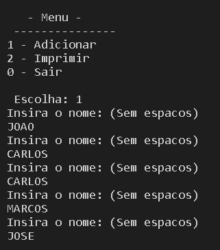
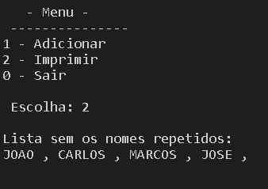
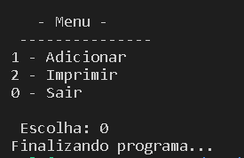
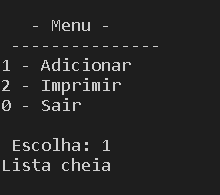

# Listas Lineares: Exercício 2

Crie uma lista linear que consiga armazenar um conjunto de 100 nomes quaisquer, os quais serão salvos de forma aleatória. Feito a estrutura crie as seguintes ações:

>*Uma função que consiga identificar replicações na lista, ou seja, nomes iguais. Remova todas as réplicas sem mover os ”ponteiro“.

>*Como você gerenciaria os espaços em branco para novas inserções? Qual seria o custo dessas novas inserções?

 Para novas inserções o mais adequado seria a alocação encadeada com o uso de apontadores. Não é preciso movimentar células para abrir espaço para um nova célula, como fizemos para inserir um novo elemento em um vetor. Basta mudar os valores de alguns ponteiros. O tempo que a função insere consome não depende do ponto da lista em que é feita a inserção: tanto faz inserir uma nova célula na parte inicial da lista quanto na parte final. 
 

Após a execução temos as telas abaixo:

 

 

 

 

# Compilação e Execução

Compilação e Execução utilizando Makefile:

| Comando                |  Função                                                                                           |                     
| -----------------------| ------------------------------------------------------------------------------------------------- |
|  `make clean`          | Apaga a última compilação realizada contida na pasta build                                        |
|  `make`                | Executa a compilação do programa utilizando o gcc, e o resultado vai para a pasta build           |
|  `make run`            | Executa o programa da pasta build após a realização da compilação                                 |

