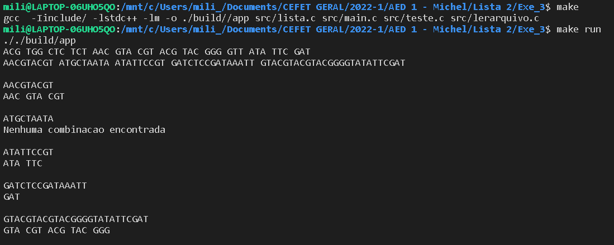

# Listas Lineares: Exercício 03

1- O problema da máxima cadeia. Elabore um programa que receba uma cadeias de
DNA. Cada posição da cadeia deve conter um códon, ou seja, uma tríade de nu cleotídeos! T,
A, G, C. Feito isso, leia de um arquivo uma sequência de nucleotídios (i.e.,
ACGTGGCTCTCTAACGTACGTACGTACGGGGTTATATTCGAT) e tente identificar a
maior cadeia da lista que se relaciona a essa entrada. 

Para a solução deste exercício foi utilizada uma "entrada.txt", que contém a sequência inicial para comparação, lida em "lerarquivo.c", os dados de teste são lidos pelo mesmo arquivo em C, mas do arquivo "entrada2.txt", com as funções "LerEntrada" e "LerTeste", na função "LerTeste", foi usada a função "Tokenizar" para quebrar as cadeias lidas en tríades.
  
Para a implementação da lista foram usados os arquivos disponibilizados pelo professor Michel Pires.
  
As Listas "codon" e "anticodon" são criadas e os arquivos lidos são comparados, imprimindo em tela a "Lista inicial de Entrada", já tokenizada, logo após imprime as "Entradas teste", abaixo disto é apresentado o resultado das comparações feitas.

 

OBSERVAÇÕES: A leitura do arquivo teste (entrada.txt) lê somente uma linha. as cadeias de teste (entrada2.txt), lê somente uma linha, por isso os testes são separados com espaços entre eles.

  
# Compilação e Execução

Makefile realiza o procedimento de compilação e execução.

| Comando                |  Função                                                                                           |                     
| -----------------------| ------------------------------------------------------------------------------------------------- |
|  `make clean`          | Apaga a última compilação realizada contida na pasta build                                        |
|  `make`                | Executa a compilação do programa utilizando o gcc, e o resultado vai para a pasta build           |
|  `make run`            | Executa o programa da pasta build após a realização da compilação                                 |

